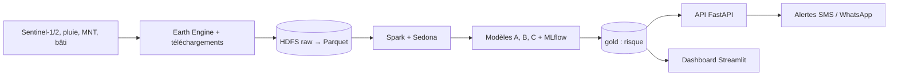

# Sentinelle Lomé

**Cartographie dynamique du risque d'inondation du Grand Lomé et exposition du bâti.**

Projet Data Science de bout en bout : chargement de données satellitaires et géospatiales volumineuses (Earth Engine, HDFS, Spark, Sedona), étiquetage radar, modélisation, tableau de bord, déploiement et piste d'alertes multilingues.

> **Statut : prototype en cours de cadrage, avec un MVP technique exécutable sur données synthétiques.** Aucun résultat de modèle n'est publié et aucune donnée réelle n'est traitée. Les valeurs de configuration marquées « À CALIBRER » ou « À CONFIRMER » sont des points de départ. Voir `docs/11_verifications_semaine1.md` et `docs/13_mvp_demo.md`.

## Question

Pour une pluie donnée, quels quartiers du Grand Lomé sont inondés, combien de bâtiments et de personnes sont exposés, et à partir de quel seuil faut-il alerter ?

## Contexte (faits vérifiés)

- Pluies nocturnes des 28-29 juin 2026 ayant inondé plusieurs quartiers de Lomé ; activation n°1037 de la Charte internationale demandée par l'ANPC le 1er juillet 2026.
- Cartes de danger existantes surtout par SIG multicritère ; carte du périurbain validée avec l'emprise Sentinel-1 de septembre 2020.
- Détails et sources : `docs/01_contexte_togo.md` et `docs/12_references.md`.

## Architecture



Détails : `docs/03_architecture.md`.

## Modèles

| Modèle | Rôle |
|---|---|
| A — Susceptibilité | Probabilité d'inondation par cellule (relief, drainage, bâti) |
| B — Déclenchement | Lien pluie → risque, avec monotonie et seuils d'alerte à coût asymétrique |
| C — Exposition | Bâtiments et population exposés par quartier |

Évaluation : validation croisée spatiale et test hors temps sur juin 2026 (`docs/05_modelisation.md`).

## Structure du dépôt

```text
sentinelle-lome/
├── README.md
├── pyproject.toml            # dépendances et extras (gee, spark, dashboard, dev)
├── Makefile                  # install, test, lint, ingest-dry, demo, api, dashboard, up, down
├── docker-compose.yml        # HDFS, Spark, MLflow, API, dashboard (non testé)
├── configs/                  # projet.yaml, evenements.yaml
├── docs/                     # documents d'étude 00 à 13 + ADR
├── src/sentinelle_lome/
│   ├── ingestion/            # exports Earth Engine, filtrage des bâtiments
│   ├── labels/               # détection d'eau par changement radar
│   ├── processing/           # variables de pluie (pandas, Spark), session Spark
│   ├── models/               # susceptibilité, déclenchement, exposition, CV spatiale
│   ├── pipeline/             # production du fichier gold (données synthétiques)
│   └── serving/              # API FastAPI
├── dashboard/app.py          # tableau de bord Streamlit
├── data/                     # raw, bronze, silver, gold (non versionné)
├── notebooks/                # 01 exploration, 02 étiquettes radar, 03 pluie (déjà exécutés, données fictives)
├── docker/                   # Dockerfiles, configuration Hadoop
└── tests/                    # 34 tests unitaires
```

## Démarrage rapide

```bash
python -m venv .venv && source .venv/bin/activate
make install                  # uv pip install -e ".[dev]"
make test                     # tests unitaires
make demo                     # produit data/gold/risque_cellules.parquet (synthétique)
make ingest-dry               # affiche le plan d'exports Sentinel-1, sans appeler Earth Engine
```

Sous Windows (PowerShell) : `.\\.venv\\Scripts\\Activate.ps1` remplace la ligne d'activation.

Pour les exports réels : `pip install -e ".[gee]"`, `earthengine authenticate`, puis
`python -m sentinelle_lome.ingestion.gee_export --projet-gee VOTRE_PROJET`.

API (avec un fichier `data/gold/risque_cellules.parquet`) : `make api`. Dashboard : `pip install -e ".[dashboard]"` puis `make dashboard`.

## MVP exécutable (données synthétiques)

La chaîne `production → API → dashboard` tourne de bout en bout sur des **données entièrement
synthétiques**. `data/` n'étant pas versionné, un clone neuf doit d'abord produire le fichier :

```bash
make demo                     # 10 670 cellules à 250 m (~30 s)
make api                      # http://127.0.0.1:8000 — /sante, /meta, /risque/point, /risque/quartier/{nom}
make dashboard                # http://localhost:8501
```

Variantes : `python -m sentinelle_lome.pipeline.gold --resolution-m 500 --scenario extreme`.

Le Parquet contient `cellule_id, quartier, lon, lat, proba_inondation, niveau_alerte` ; un fichier
`.meta.json` voisin documente la provenance, le scénario pluvieux et la calibration, et l'API
comme le dashboard l'affichent. Détails et limites : `docs/13_mvp_demo.md`.

**À lire avant toute démonstration :** `proba_inondation` est une probabilité calibrée *dans un
monde synthétique*, pas une prévision. Les niveaux d'alerte dérivent du ratio de coûts provisoire
du YAML (1:10, soit un seuil rouge à 0,0909), qui met mécaniquement une majorité de cellules en
rouge ; ce ratio doit être arbitré avec l'ANPC avant tout usage sérieux.

## Ce qui a été testé, et ce qui ne l'a pas été

| Élément | Statut |
|---|---|
| Configuration, plan d'exports, étiquettes radar, variables de pluie, modèles, CV spatiale, exposition, API, production du fichier gold | Tests unitaires passés (**34 tests**, sur données synthétiques) ; lint `ruff` propre |
| Chaîne gold → API → dashboard | Exécutée de bout en bout sur 10 670 cellules synthétiques ; API interrogée en serveur HTTP réel (dont refus hors emprise), dashboard exécuté via `streamlit.testing` sans exception |
| Notebooks 01 à 03 | Exécutés de bout en bout sans erreur ; parties Earth Engine et données réelles désactivées par défaut |
| Exports Earth Engine réels | Non exécutés (authentification requise) |
| Spark, Sedona, `docker-compose.yml` | Non exécutés ; syntaxe vérifiée seulement |
| Performances des modèles | Aucune : pas de données réelles traitées |

## Notebooks

| Notebook | Rôle | Données |
|---|---|---|
| `01_exploration_zone` | Surface de l'emprise, dimensionnement, mesures Earth Engine (bâtiments, passes Sentinel-1) | Arithmétique ; mesures réelles en option |
| `02_etiquettes_radar` | Détection d'eau, HAND, concordance des passes, sensibilité aux seuils, procédure de calibration | Scène **fictive** ; partie réelle si exports présents |
| `03_variables_pluie` | Extraction CHIRPS/IMERG, comparaison, cumuls, pluie antérieure, sélection d'événements | Pluie **fictive** ; partie réelle si CSV présents |

Les scores des parties fictives illustrent la méthode et ne disent rien sur Lomé. Lancer : `pip install -e ".[notebooks]"` puis `jupyter lab`, ou `make notebooks` pour tout ré-exécuter.


## Limites connues

Étiquettes radar bruitées en ville dense, peu d'événements, accès aux contours de la Charte et aux données drone à confirmer : `docs/04_methodologie_labels.md` et `docs/10_risques_et_ethique.md`.

Le MVP ajoute ses propres limites, détaillées dans `docs/13_mvp_demo.md` : ratio de coûts d'alerte provisoire, quartiers affectés par centroïdes approximatifs, aucun masque eau/lagune, pluie uniforme (modèle B sans effet spatial), modèle C non branché.

## Documentation

| Fichier | Contenu |
|---|---|
| `docs/00_cadrage.md` | Problème, utilisateurs, livrables, critères |
| `docs/01_contexte_togo.md` | Faits vérifiés sur Lomé |
| `docs/02_sources_de_donnees.md` | Catalogue des sources et statuts |
| `docs/03_architecture.md` | Architecture, schémas, dimensionnement |
| `docs/04_methodologie_labels.md` | Étiquettes radar et limites |
| `docs/05_modelisation.md` | Modèles A, B, C, évaluation |
| `docs/06_deploiement_et_mlops.md` | API, MLflow, Docker, suivi |
| `docs/07_dashboard.md` | Spécification du tableau de bord |
| `docs/08_integration_ia_alertes.md` | Alertes multilingues avec validation humaine |
| `docs/09_planning.md` | Calendrier |
| `docs/10_risques_et_ethique.md` | Risques, éthique |
| `docs/11_verifications_semaine1.md` | Checklist de vérifications |
| `docs/12_references.md` | Sources consultées |
| `docs/13_mvp_demo.md` | MVP exécutable : commandes, contrat de données, limites |
| `docs/adr/` | Décisions d'architecture |


## Auteur

 Cherif Abdel Azize TENGA (Data Scientist et AI Engineer).
