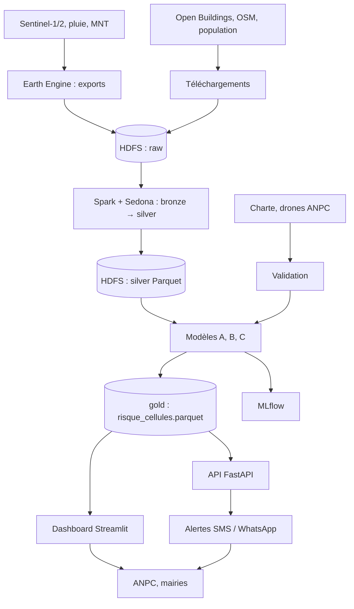

# 03 — Architecture technique

## Vue d'ensemble



## Zones de stockage (architecture en médaillon) [PROPOSITION]

| Zone | Contenu | Format |
|---|---|---|
| `raw/` | Exports bruts (GeoTIFF Sentinel-1, CSV bâtiments, pluie) | Fichiers d'origine |
| `bronze/` | Même contenu converti en tables | Parquet |
| `silver/` | Cellules, variables, pluie quotidienne, étiquettes | Parquet partitionné |
| `gold/` | Sorties de modèle prêtes à servir | Parquet |

Racine HDFS : `/sentinelle` (voir `configs/projet.yaml`).

## Schémas silver et gold [PROPOSITION]

- `silver/cellules_features` : `cellule_id, x_m, y_m, bloc_id, quartier, hand_m, pente_deg, altitude_m, dist_drain_m, densite_bati, surface_batie_m2`
- `silver/pluie_quotidienne` : `zone_id, date, pluie_mm, source`
- `silver/labels_inondation` : `cellule_id, evenement_id, inonde, confiance, passes_concordantes`
- `gold/risque_cellules` : `cellule_id, quartier, lon, lat, proba_inondation, niveau_alerte, date_calcul, version_modele`

## Pourquoi Spark est justifié (honnêtement)

Ordre de grandeur, par arithmétique pure (`sentinelle_lome.dimensionnement`) : pour une emprise **hypothétique** de 500 km² à 10 m, on a 5 millions de cellules par date ; avec 300 dates, 1,5 milliard de lignes, soit environ 96 Go bruts à 64 octets par ligne. L'emprise réelle du Grand Lomé reste à mesurer.

Répartition recommandée :
- **Earth Engine / rasterio** : calculs raster lourds (composites, HAND, indices).
- **Spark + Sedona** : jointures spatiales (bâtiments ↔ cellules ↔ quartiers), variables glissantes de pluie, assemblage des tables d'entraînement.
- **pandas / scikit-learn** : modélisation sur échantillons ou tables agrégées.

Sur un poste personnel, HDFS en nœud unique et Spark en `local[*]` ou en mini-cluster Docker suffisent. Ce choix doit être annoncé tel quel dans le rapport (apprentissage de l'architecture, pas performance de production).

## Exemple de jointure Sedona [PROPOSITION, NON TESTÉ]

```sql
SELECT c.cellule_id,
       COUNT(*)              AS n_batiments,
       SUM(b.area_in_meters) AS surface_batie_m2
FROM cellules c
JOIN batiments b ON ST_Contains(c.geom, b.geom)
GROUP BY c.cellule_id
```

## Points à épingler au premier lancement

- Versions de Spark, du JAR Sedona compatible et de Python (`SL_SEDONA_PACKAGES`).
- Images Docker (`docker-compose.yml` est un point de départ **non testé**).
